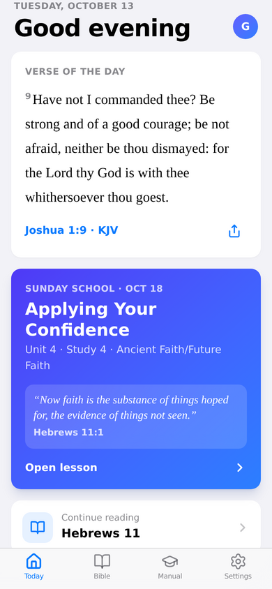
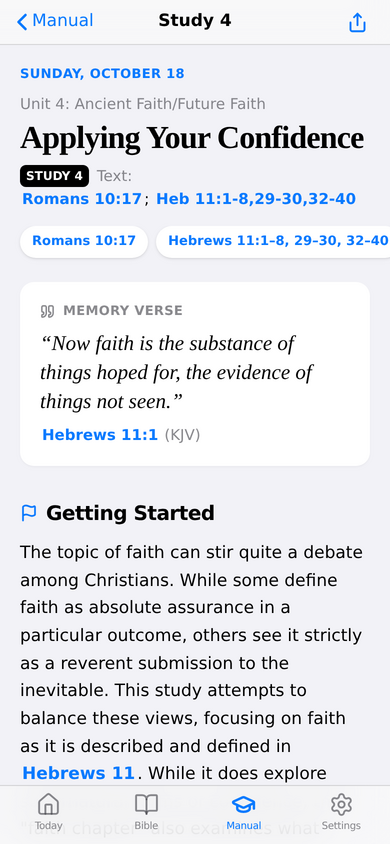
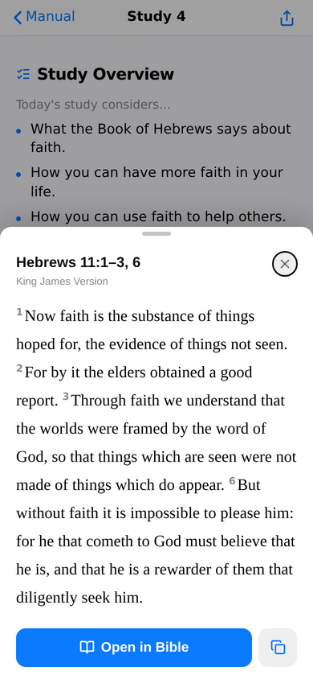
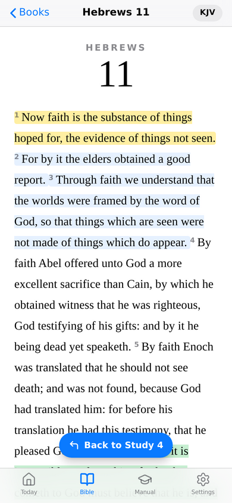
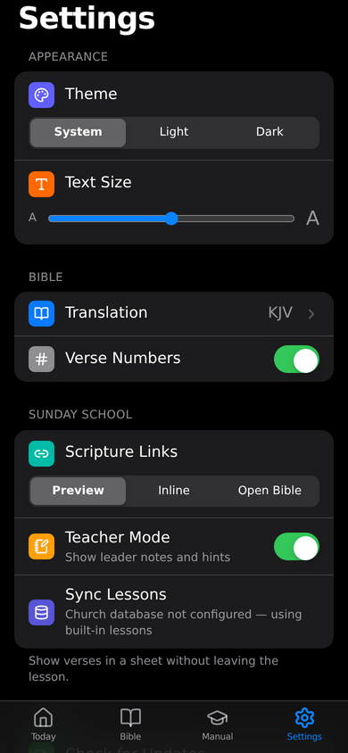

# Bible & Manual

A minimal, Apple-style church app built with **Rust + Dioxus 0.7**: a Bible reader and the
Sunday School manual (Radiant Life) in one place. Any scripture reference in a lesson, such as
`Read Heb 11:1-3,6`, becomes a link that previews the verses, expands them inline, or jumps to
the Bible with a **Back to Study 4** pill that returns you to the exact spot in the lesson.

## Features
- **Onboarding**: welcome, translation, appearance (Light/Dark/System + text size), how verse links behave, teacher mode
- **Today**: Verse of the Day, this Sunday's lesson with memory verse, today's Daily Dew Drop, continue reading
- **Bible**: KJV, WEB, BSB, ASV (public domain, offline), go-to box (`jn 3:16`), chapter grid, highlights (4 colours), bookmarks, copy/share, previous/next chapter
- **Manual**: lessons by Sunday, search, Getting Started, Study Overview, lettered discussion sections, leader notes (teacher mode), Act, Daily Dew Drops with today highlighted, "Scripture in this lesson" chips, mark complete, previous/next
- **Settings**: theme, text size, translation, verse numbers, scripture link mode, teacher mode, lesson sync (Turso), check for updates / auto-check, reset
- **Updates**: CI publishes `version.json`; Settings compares versions. The web/PWA refreshes itself; native builds open the release page
- **PWA**: installable, offline service worker

## Getting started
```bash
curl --proto '=https' --tlsv1.2 -sSf https://sh.rustup.rs | sh
rustup target add wasm32-unknown-unknown
cargo binstall dioxus-cli          # or: curl -sSL https://dioxus.dev/install.sh | bash
dx serve --platform web            # http://127.0.0.1:8080
dx serve --platform desktop        # native window
cargo test -p church-core          # parser / manual / version tests
```

## Configuration (build-time env vars, never committed)
| Variable | Purpose |
| --- | --- |
| `CHURCH_NAME` | Name on the welcome screen |
| `TURSO_DATABASE_URL` | `libsql://<db>.turso.io`: lessons published from the church database |
| `TURSO_AUTH_TOKEN` | **read-only** token (`turso db tokens create <db> --read-only`) |
| `UPDATE_MANIFEST_URL` | Absolute URL of `version.json` (CI sets it to GitHub Pages) |
| `REPO_URL` | Repository URL for release notes / downloads |

### Publishing lessons with Turso
```bash
turso db create church-manual
turso db shell church-manual < db/schema.sql
python3 db/seed_from_json.py assets/manual/manual.json | turso db shell church-manual
```
New or corrected lessons appear in the app on next launch (cached for offline use). Without Turso the app uses the bundled `assets/manual/manual.json`.

### Adding a translation
`python3 tools/import_bible.py <full-bible.json> <code>`, then add it to `src/bible/translation.rs`.
Only bundle texts you are licensed to distribute (the LSB allows at most 1,000 verses in an app without written permission from The Lockman Foundation).

## Branching & releases
See [CONTRIBUTING.md](CONTRIBUTING.md). In short: `feature/*` → PR into `develop` → PR into `main` → tag `vX.Y.Z` to release.

## Screenshots
| Today | Lesson | Verse preview | Back to lesson | Settings (dark) |
| --- | --- | --- | --- | --- |
|  |  |  |  |  |

Regenerate: `dx build --platform web --release`, then `cd tools/screenshots && npm i && python3 serve.py <public dir> 8765 & OUT=../../docs/screenshots node shoot.js`.
